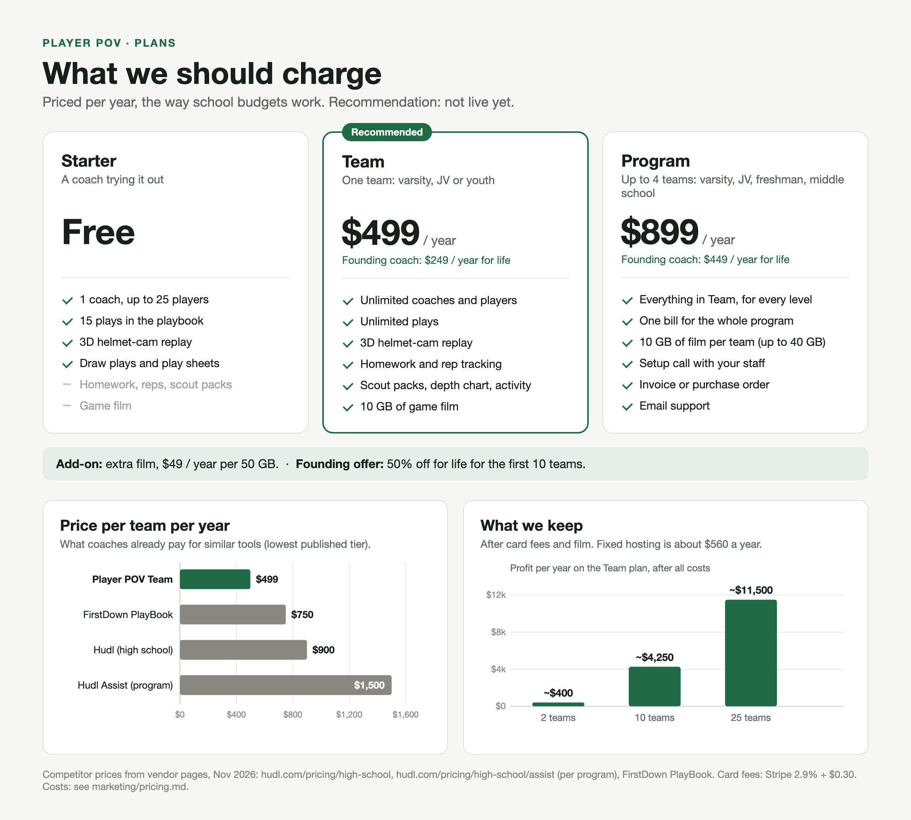

# What we should charge

Recommended plans and prices for Player POV, based on what the app costs to run (see [pricing.md](pricing.md)) and what coaches already pay for similar tools.

> **Status: recommendation, not live.** There is no billing in the app yet. Prices are in US dollars per year.

---

## The plans

|                                         | **Starter**           | **Team**                        | **Program**                                                           |
| --------------------------------------- | --------------------- | ------------------------------- | --------------------------------------------------------------------- |
| **Price**                               | Free                  | **$499 / year**                 | **$899 / year**                                                       |
| **Who it's for**                        | A coach trying it out | One team (varsity, JV or youth) | A whole program: up to 4 teams (varsity, JV, freshman, middle school) |
| **Coaches**                             | 1                     | Unlimited                       | Unlimited                                                             |
| **Players**                             | Up to 25              | Unlimited                       | Unlimited                                                             |
| **Plays in the playbook**               | 15                    | Unlimited                       | Unlimited                                                             |
| **3D helmet-cam replay**                | ✓                     | ✓                               | ✓                                                                     |
| **Draw plays, playbook, play sheets**   | ✓                     | ✓                               | ✓                                                                     |
| **Homework and rep tracking**           | —                     | ✓                               | ✓                                                                     |
| **Scout packs (weekly opponent looks)** | —                     | ✓                               | ✓                                                                     |
| **Depth chart and activity**            | —                     | ✓                               | ✓                                                                     |
| **Game film storage**                   | —                     | 10 GB                           | 10 GB per team (up to 40 GB)                                          |
| **Support**                             | Email                 | Email                           | Email, setup call                                                     |

**Add-on: Extra film, $49 / year per 50 GB.**

**Founding coach offer: 50% off for life for the first 10 teams** ($249 a year for Team, $449 for Program), in return for feedback and a quote we can use.

---

## Why these prices

### 1. Below what coaches already pay

| Tool                      | What it does                                                    | Price                                    |
| ------------------------- | --------------------------------------------------------------- | ---------------------------------------- |
| FirstDown PlayBook        | Digital playbook, unlimited users                               | $750 / year per team                     |
| Hudl (high school)        | Film and analysis                                               | $900–3,300 / year per team               |
| Hudl Assist (high school) | Film breakdown done for you                                     | $1,500–4,000 / year per program          |
| Football Play Card        | Play cards and playbook                                         | $36–180 / year per coach, teams by quote |
| **Player POV Team**       | **3D helmet-cam replay, playbook, homework, scout packs, film** | **$499 / year**                          |

- Team at $499 is about a third less than FirstDown's $750, and it adds 3D replay and film that FirstDown doesn't have.
- We are not trying to replace Hudl's film breakdown. Player POV sits next to Hudl as the tool players use to learn their assignments.
- $499 is low enough that a head coach can often pay from a booster or team budget without a long approval.

### 2. Strong margin over our costs

|                                                        | Team                    | Program           |
| ------------------------------------------------------ | ----------------------- | ----------------- |
| Price                                                  | $499                    | $899              |
| Card processing (Stripe, 2.9% + $0.30)                 | −$14.77                 | −$26.37           |
| Film storage, a heavy year (about 20 GB kept all year) | −$1.80                  | −$12.60 (4 teams) |
| Email and function calls                               | $0 (inside free limits) | $0                |
| **Kept per customer, before fixed hosting**            | **$482**                | **$860**          |

The fixed costs are about $560 a year: $540 for paid hosting (Supabase Pro + Vercel Pro) plus a domain.

- **2 Team customers** (or 1 Program) cover all fixed costs for the year.
- **10 Team customers:** about $4,800 kept, minus about $560 fixed, leaves **about $4,250 a year**.
- **25 Team customers:** about $12,050 kept, minus about $560 fixed, leaves **about $11,500 a year**. Hosting stays the same until well past this.

Stripe isn't connected yet. Its fee is the only cost that grows with every sale.

### 3. Built around how schools buy

- **Priced per year**, because school budgets and purchase orders are annual. Offer an invoice for schools that can't pay by card.
- **Program pricing** lets a head coach buy once for every level, the way Hudl sells.
- **Starter stays free and small** so a coach can try the 3D replay with a few plays before asking anyone for money. It costs us almost nothing: no film and a small database.

### 4. Film is priced well above its cost

- 50 GB of film costs us about $9 a year on Cloudflare R2. The add-on is $49.
- Each paid team gets 10 GB, which matches the app's default limit per team, so no setting needs changing.

---

## What to decide before launch

- [ ] Final prices (this file is a starting point).
- [ ] Whether Starter's limits (1 coach, 25 players, 15 plays) need to be enforced in the app, or just stated.
- [ ] Connect payments: Stripe Checkout for card, plus invoices for schools.
- [ ] Move to the paid setup before the first paid team: Vercel Pro and Supabase Pro.
- [ ] Buy a domain and set up Resend email on it, so invites reach players.

---

## Sources

- [Hudl high school pricing](https://www.hudl.com/pricing/high-school)
- [Hudl Assist high school pricing](https://www.hudl.com/pricing/high-school/assist)
- [FirstDown PlayBook pricing](https://firstdown.playbooktech.com/coaches-community/consistent-transparent-playbook-pricing)
- [Football Play Card pricing](https://footballplaycard.com/pricing)
- [Stripe pricing](https://stripe.com/pricing)

Competitor prices were checked November 2026 and come from vendor pages and posts. Confirm them before quoting a competitor to a coach.

## Change log

| Date       | Change                                                    |
| ---------- | --------------------------------------------------------- |
| 2026-11-22 | Created with recommended Starter, Team and Program plans. |
