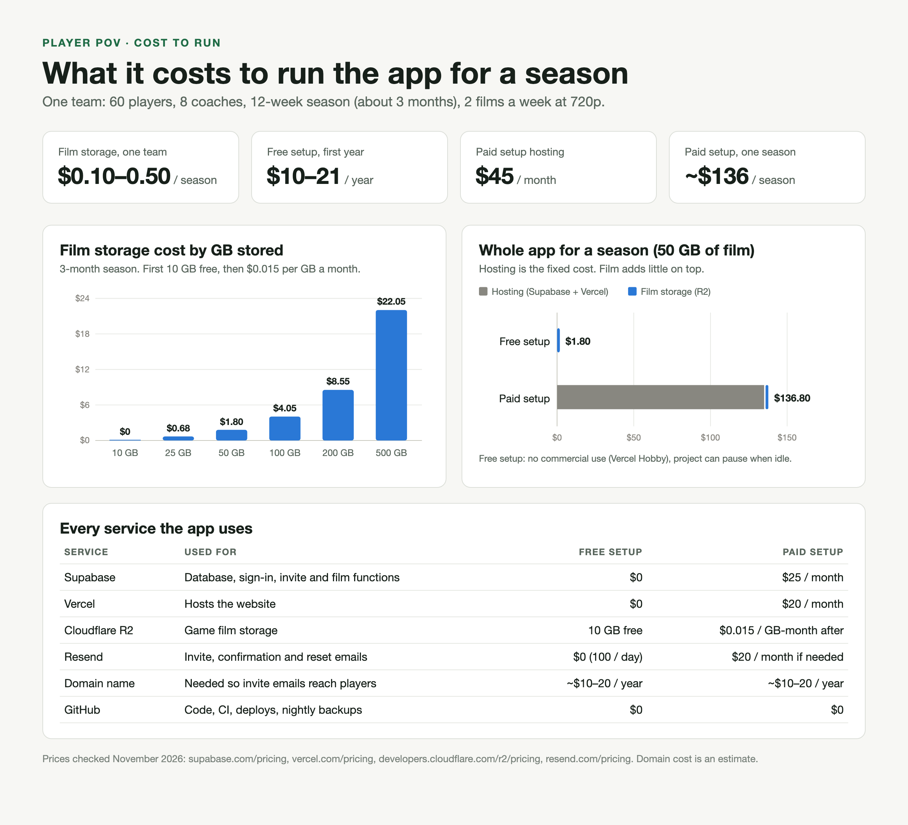

# Pricing tracker

What Player POV costs to run, and what we charge for it. Use this when pitching coaches, setting plan prices, or checking margins.

Update the **Last checked** date whenever a vendor price is re-verified, and add a line to the change log at the bottom.

---

## 1. What we pay (vendor subscriptions)

This is every outside service the app uses today. I checked it against the code: `package.json`, the Supabase functions, the env vars and `.github/workflows`.

| Service       | What it does for the app                                                                            | Plan now           | Cost now                      | Paid plan             | Paid cost                                           | Last checked |
| ------------- | --------------------------------------------------------------------------------------------------- | ------------------ | ----------------------------- | --------------------- | --------------------------------------------------- | ------------ |
| Supabase      | Database, sign-in, access rules, the `invite-member` and `film-storage` functions                   | Free               | $0                            | Pro                   | $25 / month per org                                 | Nov 2026     |
| Vercel        | Hosts the website (`player-pov.vercel.app`)                                                         | Hobby              | $0                            | Pro                   | $20 / month per seat                                | Nov 2026     |
| Cloudflare R2 | Game film storage                                                                                   | Free allowance     | $0 (under 10 GB)              | Pay as you go         | $0.015 per GB-month after 10 GB                     | Nov 2026     |
| Resend        | Sends sign-in emails through Supabase: player and coach invites, email confirmation, password reset | Free               | $0 (3,000 / month, 100 / day) | Pro                   | $20 / month (50,000 / month, no daily cap)          | Nov 2026     |
| Domain name   | Resend needs a domain we own to send email to anyone but ourselves. Optional for the website        | **None yet**       | —                             | One `.com` or similar | About $10–20 / year (estimate, varies by registrar) | Nov 2026     |
| GitHub        | Code, CI, the database deploy, nightly encrypted backups, the keep-awake ping                       | Free (public repo) | $0                            | Not needed            | $0 while the repo is public                         | Nov 2026     |

**Totals:**

- **Free setup:** $0 a month, plus about $10–20 a year for a domain once we invite real players.
- **Paid setup:** about **$45 a month** (Supabase Pro + Vercel Pro), plus the domain.
- **Resend Pro (+$20 a month)** is only needed past 100 emails a day or 3,000 a month.
- R2 film storage is on top of all of these; see section 2.

### Free things the app already depends on

- **GitHub Actions:** CI, deploys, nightly backups and a ping every 2 days that keeps the free Supabase project from pausing. Free minutes are unlimited on a public repo. If the repo goes private, the free plan includes 2,000 minutes a month, which should still cover this.
- **Backups** are kept as GitHub artifacts for 30 days, free on a public repo. On Supabase Pro, daily backups come built in as well.
- **No other paid APIs.** No maps, AI, SMS, analytics or payment provider is wired in. Fonts and the 3D libraries are bundled into the site.

### Free setup limits (why we'd switch to paid)

- **Vercel Hobby is for non-commercial use only.** We must move to Pro before charging anyone.
- **A free Supabase project pauses after 7 days with no activity.** That's fine in season, but it can pause in the off-season.
- **Supabase Free has no daily backups.** Pro includes 7 days of them.
- **Supabase Free includes a 500 MB database and 50,000 monthly active users.** Pro includes an 8 GB disk and 100,000 monthly active users.

### R2 details

| Item                | Free each month | After that           |
| ------------------- | --------------- | -------------------- |
| Storage             | 10 GB           | $0.015 per GB-month  |
| Uploads (writes)    | 1,000,000       | $4.50 per million    |
| Streaming (reads)   | 10,000,000      | $0.36 per million    |
| Data out to viewers | Unlimited       | Free (no egress fee) |

- The free allowance is per Cloudflare account, so every team shares one 10 GB.
- Cloudflare has no hard spending cap. Each team's storage is capped in the app instead (default 10 GiB, `teams.film_quota_bytes`).

**Sources:**

- [Resend pricing](https://resend.com/pricing) and [Resend sending limits](https://resend.com/docs/knowledge-base/resend-sending-limits)
- [Supabase custom SMTP](https://supabase.com/docs/guides/auth/auth-smtp) and [Supabase production checklist](https://supabase.com/docs/guides/deployment/going-into-prod)
- [Supabase pricing](https://supabase.com/pricing)
- [Vercel pricing](https://vercel.com/pricing)
- [Vercel Hobby plan](https://vercel.com/docs/plans/hobby)
- [Cloudflare R2 pricing](https://developers.cloudflare.com/r2/pricing/)
- [Supabase Edge Functions pricing](https://supabase.com/docs/guides/functions/pricing)

---

## 1b. Enrolling one team: what it costs today

A typical team: 60 players and 8 coaches, a 12-week season, 2 films a week at 720p.

| Item                    | One team uses                                                                             | Free limit                  | Cost for one team                          |
| ----------------------- | ----------------------------------------------------------------------------------------- | --------------------------- | ------------------------------------------ |
| Supabase users          | ~68 accounts                                                                              | 50,000 monthly active users | $0                                         |
| Supabase database       | Under 50 MB (whole project is 13 MB today)                                                | 500 MB                      | $0                                         |
| Supabase function calls | A few thousand a season (invites + film uploads and playback)                             | 500,000 / month             | $0                                         |
| Emails (Resend)         | ~150 at sign-up: 68 invites, 68 confirmations, some resends and resets. Then a few a week | 100 / day, 3,000 / month    | $0, if invites are spread over 2 days      |
| Film storage (R2)       | Peaks at ~36 GB if all film is kept; ~20 GB if opponent film is deleted after each game   | 10 GB free                  | About $0.10–$0.50 for the season           |
| Website (Vercel)        | Normal traffic                                                                            | Hobby limits                | $0, but Hobby doesn't allow commercial use |
| Domain                  | Needed so invite emails reach players                                                     | —                           | About $10–20 / year                        |

**Bottom line for one team:**

- **Free setup:** about **$10–21 for the first year**: the domain, plus under $1 of film.
- **Paid setup, needed once we charge:** about **$136 for a 3-month season**, mostly the $45 a month hosting. Add the domain once a year.

**Things that could block enrollment** (not costs, but check them first):

- **Custom email must be set up.** Without custom SMTP, Supabase's built-in email only delivers to our own project team's addresses, a couple an hour. Invites to real players won't arrive.
  - Check Supabase → Authentication → SMTP Settings and confirm Resend is connected with a verified domain.
- **Sending limits.** Even with custom SMTP, Supabase allows 30 emails an hour by default, and Resend Free allows 100 a day.
  - Inviting a full 60-player roster in one sitting can hit those limits.
  - Either invite in batches, or raise the hourly limit in Supabase's Rate Limits settings.
- **Film space.** A team goes past the default 10 GiB team limit around week 4 if it keeps all film, or week 7 if it deletes opponent film after each game. Raise that team's `film_quota_bytes` before then.

---

## 2. Cost per feature

### Game film

Film size at the usual export settings:

- 720p: about 1 GB per hour
- 1080p: about 3 GB per hour
- Straight off the camera (4K): about 10 GB per hour

Film storage cost by GB stored. The first 10 GB is free; a season is 12 weeks, about 3 months:

| Film stored | About (720p) | Per month | Season | Full year |
| ----------- | ------------ | --------- | ------ | --------- |
| 10 GB       | 10 hours     | $0.00     | $0.00  | $0.00     |
| 25 GB       | 25 hours     | $0.23     | $0.68  | $2.70     |
| 50 GB       | 50 hours     | $0.60     | $1.80  | $7.20     |
| 100 GB      | 100 hours    | $1.35     | $4.05  | $16.20    |
| 200 GB      | 200 hours    | $2.85     | $8.55  | $34.20    |
| 500 GB      | 500 hours    | $7.35     | $22.05 | $88.20    |

- These figures assume that much film sits in storage the whole time, so they're the high end.
- Uploads and streaming add only cents.
- Interactive estimate: [Game film season cost](https://claude.ai/artifact/47Yb4L6C4GnXMAQe1oYtVc). It's private; share it from the page's Share menu. A copy is at `~/Desktop/game-film-season-cost.html`.

### Everything else (playbook, scout packs, reps, depth chart)

Database only. It runs inside the Supabase plan at no extra cost per team until we near the plan limits above.

---

## 3. Cost to run, by number of teams

Paid setup ($45 a month hosting) for a 3-month season, at about 20 GB of film per team (720p, keeping all film):

| Teams | Hosting / season | Film / season | Total / season | Cost per team |
| ----- | ---------------- | ------------- | -------------- | ------------- |
| 1     | $135             | $0.45         | $135.45        | $135.45       |
| 5     | $135             | $4.05         | $139.05        | $27.81        |
| 10    | $135             | $8.55         | $143.55        | $14.36        |
| 25    | $135             | $22.05        | $157.05        | $6.28         |
| 50    | $135             | $44.55        | $179.55        | $3.59         |

- Film cost here is (teams × 20 GB − 10 GB free) × $0.015 × 3 months. Hosting is fixed, so cost per team drops fast as teams are added.
- 20 GB per team is above the app's default 10 GiB team limit. Either raise that team's `film_quota_bytes`, or have coaches delete opponent film after the game.

---

## 4. What we charge (customer plans)

> **Status: not set.** There's no billing in the app yet. Fill this in once plans are decided.

| Plan           | Price | Billing | Who it's for | What's included | Film storage | Status |
| -------------- | ----- | ------- | ------------ | --------------- | ------------ | ------ |
| _e.g. Free_    |       |         |              |                 |              | Draft  |
| _e.g. Team_    |       |         |              |                 |              | Draft  |
| _e.g. Program_ |       |         |              |                 |              | Draft  |

**Questions to settle:**

- Per team, per program (varsity + JV + freshman), or per school?
- Per season or per month? Most programs budget per season.
- Is game film part of a paid plan, or an add-on with its own storage size?
- What does a free plan keep, if anything, so coaches can try it first?

### Break-even check

The paid setup costs about **$135 a season** before film. Plan prices only need to cover that once:

| Price per team per season | Teams to cover hosting |
| ------------------------- | ---------------------- |
| $25                       | 6                      |
| $50                       | 3                      |
| $100                      | 2                      |

---

## Change log

| Date       | Change                                                                                                                                                                             |
| ---------- | ---------------------------------------------------------------------------------------------------------------------------------------------------------------------------------- |
| 2026-11-22 | Added Resend, a domain name and GitHub after checking the code for every outside service. Added "Enrolling one team". Production today: 2 users, 2 teams, 13 MB database, 0 films. |
| 2026-11-22 | Created. Vendor prices checked: Supabase, Vercel, Cloudflare R2. Game film launched on the free setup for a proof of concept.                                                      |
